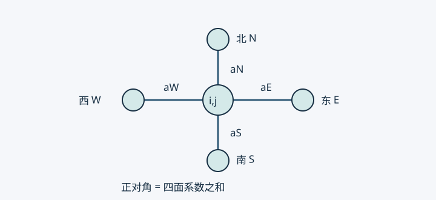

# 03 · 二维差分与线性方程组性质

> 来源：S01 物理第 3 页。通量推导、热阻解释、矩阵证明与算法条件为编写者补充。

## 五点格式是四条边的热量收支 {#kp-five-point}

设 $-\nabla\cdot(k\nabla T)=Q$，已知 $k(x,y)>0$，待求 $T(x,y)$。矩形网格步长为 $h_x,h_y$，$T_{ij}$ 是近似温度。东面数学通量为 $k_{i+1/2,j}(T_{i+1,j}-T_{ij})/h_x$，西面同理。两面相减再除以 $h_x$ 近似散度，$y$ 方向重复后取负号，得

$$
(a_E+a_W+a_N+a_S)T_{ij}-a_ET_{i+1,j}-a_WT_{i-1,j}-a_NT_{i,j+1}-a_ST_{i,j-1}=Q_{ij},
$$

其中 $a_E=k_{i+1/2,j}/h_x^2,a_W=k_{i-1/2,j}/h_x^2,a_N=k_{i,j+1/2}/h_y^2,a_S=k_{i,j-1/2}/h_y^2$。同一条网格边在两侧方程使用相同面系数。

图中每条边只有一个面系数，说明为什么相邻两节点的耦合应一致。若 $k$ 为常数且 $h_x=h_y=h$，得

$$
4T_{ij}-T_{i+1,j}-T_{i-1,j}-T_{i,j+1}-T_{i,j-1}=h^2Q_{ij}/k.
$$

无源时中心温度等于四邻点平均。光滑解的常系数模板误差为 $O(h_x^2+h_y^2)$；矩形网格本身不降低阶数。九点高阶格式需同时修正源项和边界，不能只增加四个角点便宣称四阶。

给定空间系数 $k(x,y)$ 不破坏线性；若 $k$ 依赖未知温度，通常为非线性。

## 调和平均的物理前提 {#kp-harmonic}

两节点距离 $h$，材料界面恰在中点，两侧导热率为 $k_L,k_R$。串联稳态传热的通量相同，总热阻相加，因此

$$
\frac{h}{k_{\rm eff}}=\frac{h}{2k_L}+\frac{h}{2k_R},\qquad k_{\rm eff}=\frac{2k_Lk_R}{k_L+k_R}.
$$

例如 $k_L=1,k_R=9$，等效值为 $1.8$，算术平均 $5$ 会低估这段串联热阻。若两侧厚度为 $d_L,d_R$，应改为 $(d_L+d_R)/(d_L/k_L+d_R/k_R)$。对于给定光滑系数，面值或适当算术插值也可能二阶一致；并非任何算术平均都破坏守恒。守恒关键在两侧使用一致的面通量。

## 已知边界必须修正右端 {#kp-dirichlet}

设全量系统为 $Au=b$。自由节点集合为 $F$，已知节点集合为 $D$，已知值为 $d$。分块后自由行是

$$
A_{FF}u_F+A_{FD}d=b_F\quad\Longrightarrow\quad\boxed{A_{FF}u_F=b_F-A_{FD}d}.
$$

这就是“删行删列＋修正右端”。原已知行可在求解后用于恢复反力或边界收支。

| 做法 | 性质 |
| --- | --- |
| 删已知行列并修正右端 | 保持对称的缩减系统 |
| 先修正右端，再同时清零行列、对角置 1、边界右端置 $d$ | 原规模且保持对称 |
| 只将已知行改为单位行 | 解可相同，但一般破坏对称 |
| 对角加大罚数、右端加罚数乘已知值 | 可保持对称，但约束近似，通常恶化条件数 |

例如 $A=\begin{bmatrix}1&-1&0\\-1&2&-1\\0&-1&1\end{bmatrix}$，$b=0$，两端给 $u_0=1,u_2=3$。自由行变成 $2u_1=4$。若遗漏移项，会误得 $u_1=0$。

## 为什么稀疏、对称、正定 {#kp-spd}

每个内点最多耦合五个未知量，故非零元数量为 $O(N)$，$N$ 是未知节点数。编号改变带宽，不改变物理问题。半带宽 $b$ 的常规带状直接分解通常需要 $O(Nb^2)$ 运算，二维直接求解不能一概说成线性复杂度。

共享正面权的规则网格扩散矩阵满足

$$
z^TAz=\sum_{\{i,j\}}w_{ij}(z_i-z_j)^2,
$$

无向边各计一次，$w_{ij}>0$。$z$ 是任意节点变化，消元后取 $z_D=0$。各项非负，未约束矩阵因此半正定。若每个网格连通分量都连到已知边界，零能量迫使沿每条边 $z_i=z_j$，再由边界为零得全场为零，故自由矩阵正定。对称性来自共享权值。

纯 Neumann 且无反应项时，常数向量是零模态；需兼容条件和均值等约束。非负 Robin 能量也可消除常数模态，但必须约束所有连通分量。非均匀网格体积归一化后，矩阵可能只在加权内积下对称，需要另行分析。

## 对角占优与求解器适用条件 {#kp-solvers}

原五点模板的对角恰等于邻边系数之和。消去已知节点后，其邻近自由行可能严格占优。源项只改变右端，不能使矩阵严格占优。

对连通、正权、至少一行严格占优的不可约弱对角占优扩散矩阵，Jacobi 和 Gauss-Seidel 收敛；只有弱占优本身不够。SPD（对称正定）矩阵可用 Cholesky 或共轭梯度 CG；CG 不能只检查对称。对 SPD，SOR 取 $0<\omega<2$ 是常用收敛条件。

$u=A^{-1}b$ 是数学表达式，实际用分解或迭代，通常不显式求逆。残差 $b-Au$ 小并不保证同等小的解误差，条件数决定误差放大上界。

有限元也会得到稀疏能量矩阵，但一般网格、各向异性和高阶元未必对角占优。[下一章](./04-有限元法入门-一维杆件与变分原理.md)从杆件能量构造弱形式。

自测：只改三节点例子的首末行，为什么不再对称？改变右端热源会改变特征值吗？为什么未约束的扩散刚度矩阵不能直接用 Cholesky？
