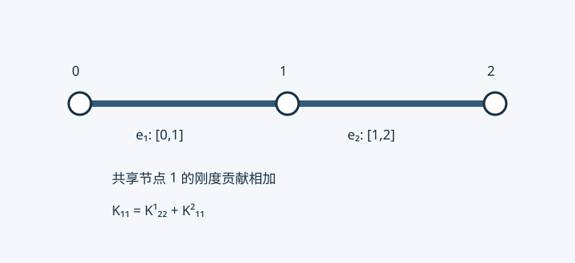

# 08 · 二维单元刚度矩阵与总体装配

> 课堂来源：S01 物理第 13–15 页。旧稿提及的录音原件当前未提供，不能核实引语、时间戳、课次、作业及考核安排；本章只以可见板书为课堂依据。Q4 手算矩阵、Q9 显式构造和坐标变换是解释补充。

## 从积分式读出矩阵 {#kp-element-2d}

[第 6 章](./06-一般二阶ODE与二维Poisson有限元.md)已经构造二维标量扩散问题的弱形式。现在要把积分变成能存入计算机的系数。对一个有 $m$ 个节点的单元 $e$，设 $N=[N_1,\ldots,N_m]$ 是形函数行阵，$u_e$ 是 $m\times1$ 节点场值列向量，$v_e$ 是检验函数的节点系数。于是

$$
u_h=Nu_e,\qquad \nabla u_h=Bu_e,\qquad B=\begin{bmatrix}N_{1,x}&\cdots&N_{m,x}\\N_{1,y}&\cdots&N_{m,y}\end{bmatrix}.
$$

$B$ 为 $2\times m$，在标量扩散问题中称梯度矩阵；它与二维弹性力学的应变矩阵维度不同。将 $v_h=Nv_e$ 同时代入积分，节点系数与积分变量无关，便可提出：

$$
\int_e k\nabla u_h\cdot\nabla v_h\,\mathrm dA
=v_e^T\underbrace{\left(\int_e B^TkB\,\mathrm dA\right)}_{K^e}u_e.
$$

这里 $k$ 是标量，不必硬写成 $2\times2$；各向异性时才用正定导热张量 $D$ 替代 $k$。矩阵元素为

$$
K^e_{ij}=\int_e k(N_{i,x}N_{j,x}+N_{i,y}N_{j,y})\,\mathrm dA.
$$

两个方向相加，不能把 $y$ 项误写成减号。它关于 $i,j$ 对称。$K^e$ 为 $m\times m$，且纯扩散时单位分解 $\sum_iN_i=1$ 意味着 $K^e\boldsymbol1=0$。这表示常数场没有梯度能量；不是完整边界约束后的矩阵仍奇异。

## Q4 单元的一个完整积分 {#kp-q4-matrix}

在单位正方形 $[0,1]^2$ 上，按左下、右下、右上、左上编号。取 $k=1$，形函数为 $(1-x)(1-y),x(1-y),xy,(1-x)y$。例如 $N_{1,x}=-(1-y),N_{1,y}=-(1-x)$，故

$$
K^e_{11}=\int_0^1\int_0^1[(1-y)^2+(1-x)^2]\,\mathrm dx\,\mathrm dy=\frac23.
$$

再算 $K^e_{12}=\int[-(1-y)^2+x(1-x)]\,\mathrm dA=-1/6$。其余项同样计算，得到

$$
K^e=\frac16\begin{bmatrix}4&-1&-2&-1\\-1&4&-1&-2\\-2&-1&4&-1\\-1&-2&-1&4\end{bmatrix}.
$$

行和为零，特征值为 $0,2/3,1,1$。常数体源 $f$ 的载荷向量为 $f^e=(f/4)[1,1,1,1]^T$。这些结果由实验脚本以独立积分验证。

## 边界也有单元贡献 {#kp-boundary-element}

对 Robin 边 $\gamma$，$k\partial_nu+\alpha u=g$。边上仍使用场的插值迹，因而

$$
K^\gamma=\int_\gamma\alpha N^TN\,\mathrm ds,\qquad f^\gamma=\int_\gamma gN^T\,\mathrm ds.
$$

若直边长 $\ell$，两端线性形函数且 $\alpha,g$ 为常数，则

$$
K^\gamma=\frac{\alpha\ell}{6}\begin{bmatrix}2&1\\1&2\end{bmatrix},\qquad f^\gamma=\frac{g\ell}{2}\begin{bmatrix}1\\1\end{bmatrix}.
$$

所以 Robin 边界一般不只是“在一个对角元加 $\alpha$”：还耦合边两端。Neumann 取 $\alpha=0$，仅有载荷；Dirichlet 在自由度消元时处理。对不与坐标轴平行的直边不能随意用 $\mathrm dx$ 或 $\mathrm dy$ 替代 $\mathrm ds$。

## 装配是局部编号到全局编号的累加 {#kp-assembly-map}

设单元连接表为 $I_e=[i_1,\ldots,i_m]$，含每个局部节点的全局编号。局部条目 $K^e_{ab}$ 应加入全局 $K_{i_ai_b}$；载荷也累加到 $F_{i_a}$。可以引入提取矩阵 $P_e$，使 $u_e=P_eu$，则

$$
K=\sum_eP_e^TK^eP_e+\sum_\gamma P_\gamma^TK^\gamma P_\gamma,\qquad
F=\sum_eP_e^Tf^e+\sum_\gamma P_\gamma^Tf^\gamma.
$$

共享节点的贡献相加，独立单元的局部节点号即使相同也不能直接叠在同一个位置。节点号、自由度号、自由方程号是不同概念：标量问题每节点一个自由度，二维弹性问题每节点通常两个。已知自由度不列入自由方程，但其列乘已知值要移到右端。具体分块消元见[第 3 章](./03-二维差分与线性方程组性质.md#kp-dirichlet)。

图用两个一维单元突出编号映射；二维装配规则完全相同，只是每个局部块更大。20 个标量节点、其中 8 个给定值时有 12 个自由未知量，这是计数示例，不能由一个模糊板书矩阵恢复所有边界节点的具体编号。

## 能量证明可解性的条件 {#kp-coercivity}

对满足齐次 Dirichlet 约束的任意离散变化 $z_h$，

$$
z^TK_{FF}z=\int_\Omega k|\nabla z_h|^2\,\mathrm dA+\int_{\Gamma_R}\alpha z_h^2\,\mathrm ds.
$$

若区域连通、$k\ge k_0>0$，零能量迫使 $z_h$ 是常数。具有正边界测度的 Dirichlet 部分上 $z_h=0$，或者足够的正 Robin 约束，会迫使该常数为零。因此自由矩阵 SPD。多连通分量要分别约束；欠积分产生额外零模态、退化网格或错误装配时，不能只因“处理过边界”就保证可逆。此式对变化 $z_h$，不是将任意非零边值解本身代入就能证明正定。

## 九节点双二次单元 {#kp-q9}

S01 第 15 页画出九节点布局。这里补全构造，保留其数学内容，不将页上“考试”的个人批注解释为教师考核承诺。参考坐标取 $\xi,\eta\in[-1,1]$，每个方向的节点为 $-1,0,1$。一维二次基函数是

$$
\ell_-(s)=\frac{s(s-1)}2,\quad\ell_0(s)=1-s^2,\quad\ell_+(s)=\frac{s(s+1)}2.
$$

二维函数取九种张量积 $N_{ab}=\ell_a(\xi)\ell_b(\eta)$。例如中心节点 $N_9=(1-\xi^2)(1-\eta^2)$。板书编号为四角 1–4、下右上左边中点 5–8、中心 9；程序连接表必须与此一致。

$N$ 为 $1\times9$，标量梯度矩阵 $B$ 为 $2\times9$，$K^e$ 为 $9\times9$。双二次空间含 $\xi^2\eta^2$，区别于六节点三角形的总次数二次空间。控制方程二阶并不意味着线性元不能求解；提高次数是为了在光滑性允许时提高近似能力。

## 参考单元、Jacobian 与 Gauss 积分 {#kp-isoparametric}

复杂几何不宜逐单元手算。用相同形函数插值几何与场：$x=\sum N_ix_i,y=\sum N_iy_i,u_h=\sum N_iu_i$，称等参表示。明确约定

$$
J=\begin{bmatrix}x_\xi&x_\eta\\y_\xi&y_\eta\end{bmatrix},\qquad
\begin{bmatrix}u_\xi\\u_\eta\end{bmatrix}=J^T\begin{bmatrix}u_x\\u_y\end{bmatrix}.
$$

因此物理梯度是 $J^{-T}$ 乘参考梯度，而面积微元为 $\mathrm dA=|\det J|\,\mathrm d\xi\mathrm d\eta$。这两个变换不能漏掉任一个。几何映射还应一一对应、无折叠；有限元程序通常要求一致正定向的 $\det J>0$，不能靠绝对值掩盖无效网格。

一维两点 Gauss 在 $[-1,1]$ 上为节点 $\pm1/\sqrt3$、权重均为 1，精确到三次多项式。二维取张量积。常系数仿射矩形 Q4 刚度可用 $2\times2$ 点精确积分，仿射 Q9 常用 $3\times3$ 点；变系数、非仿射畸变单元需检查积分精度，不能承诺同样精确。三角形参考域不同，不应套用整个正方形的积分限。

参数化直边或曲边 $\boldsymbol r(s)$ 时，$\mathrm ds_{\rm arc}=|\boldsymbol r'(s)|\,\mathrm ds$。三角形也完全可以直接在物理坐标解析积分，面积坐标和参考映射是方便的工具，不是唯一合法方法。

自测：为什么 $K^e\boldsymbol1=0$ 与施加边界后的 SPD 不矛盾？若一条 Robin 边长 2、$\alpha=3,g=4$，其边界矩阵和载荷各是什么？[下一章](./09-三角形单元与面积坐标.md)处理三角形。
