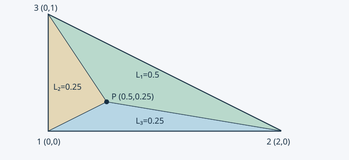

# 09 · 三角形单元与面积坐标

> 课堂依据：2026.10.19 文件夹中照片 C01、C02、C03、C06、C07（三角形线性插值、行列式、面积坐标）；照片编号与文件名见[来源覆盖](./来源覆盖.md)。单元矩阵、二次三角形和手算例题为编写者解释补充。

## 为什么从矩形转向三角形 {#kp-triangle-space}

矩形张量积插值很方便，但不规则边界未必能用规则矩形贴合。将多边形划分为三角形，便可在每个三角形上定义低次多项式，再通过共享边的节点值保持连续。曲边仍需几何近似或曲边单元，三角剖分并非自动精确表示曲线。

一个三节点三角形上，未知标量场用一次多项式

$$
u_h(x,y)=a+bx+cy
$$

表示。$a,b,c$ 是待定系数。一次二维多项式空间 $P_1=\operatorname{span}\{1,x,y\}$ 维度是 3，因此三个不共线节点值恰好决定它。与 Q4 的 $\operatorname{span}\{1,x,y,xy\}$ 不同，不能给三节点单元再塞入第四个独立系数。

## 由节点条件解出形函数 {#kp-triangle-shape}

三个节点坐标为 $(x_i,y_i)$，节点场值为 $u_i$，$i=1,2,3$。代入上式：

$$
\begin{bmatrix}1&x_1&y_1\\1&x_2&y_2\\1&x_3&y_3\end{bmatrix}
\begin{bmatrix}a\\b\\c\end{bmatrix}=\begin{bmatrix}u_1\\u_2\\u_3\end{bmatrix}.
$$

节点逆时针编号时，矩阵行列式等于 $2A>0$，其中 $A$ 是面积。逆矩阵存在等价于三点不共线。将求出的系数代回并按 $u_i$ 收集，得到 $u_h=\sum_iN_iu_i$。

为避免逐次求逆，定义循环系数（$i,j,k$ 依次取 $(1,2,3),(2,3,1),(3,1,2)$）：

$$
a_i=x_jy_k-x_ky_j,\qquad b_i=y_j-y_k,\qquad c_i=x_k-x_j.
$$

于是

$$
\boxed{N_i(x,y)=\frac{a_i+b_ix+c_iy}{2A}}.
$$

这里 $a_i,b_i,c_i$ 是几何已知量，区别于场近似的待定系数 $a,b,c$。量纲上分子、分母均为面积，$N_i$ 无量纲。若换为顺时针编号，应一致使用有向行列式，或先重排节点，不能只对分母取绝对值而不改分子。

把节点 $i$ 代入 $N_i$ 得 1，代入另两节点得 0；这也是求形函数的一种方法：让每个形函数在自己的节点取 1，其他节点取 0。由此有 $N_i(x_j,y_j)=\delta_{ij}$。

## 面积比为什么就是线性形函数 {#kp-barycentric}

对三角形内一点 $P$，连接它与三个顶点，将面积分为 $A_1,A_2,A_3$，其中 $A_i$ 是与顶点 $i$ 相对的子三角形面积。固定对边时，子三角形的底不变、高度随 $P$ 的坐标线性变化，因而 $A_i/A$ 也是线性函数。它在顶点 $i$ 为 1，在另两个顶点为 0，和 $N_i$ 满足同样的三个条件，故

$$
N_i=L_i=\frac{A_i}{A},\qquad L_1+L_2+L_3=1.
$$

图中三个小三角形分别与三个顶点对应。只有点在内部时三个普通面积比均非负；外部延拓要用有向面积，不能继续把绝对面积比相加当作单位分解。

<BarycentricDemo />

交互仅改变内部点的位置，观察三个权重如何保持和为 1。无 JavaScript 时仍可读上方静态图：示例三角形 $(0,0),(2,0),(0,1)$，点 $(0.5,0.25)$ 的权重为 $(0.5,0.25,0.25)$。

单位分解还说明常数场能精确恢复。更强地，$\sum_iN_ix_i=x,\sum_iN_iy_i=y$，因此任意线性场都能精确插值。相邻三角形的公共边上，两个迹都是由相同两端值决定的一维线性函数，故整张网格的 $u_h$ 连续；梯度无需跨边连续。

## 梯度与常系数单元矩阵 {#kp-triangle-stiffness}

由于 $N_i$ 线性，梯度为常向量：

$$
B=\frac1{2A}\begin{bmatrix}b_1&b_2&b_3\\c_1&c_2&c_3\end{bmatrix},\qquad K^e=kA B^TB.
$$

标量问题每节点一个自由度，所以 $B$ 为 $2\times3$，刚度为 $3\times3$。常数源 $f$ 有 $f_i^e=f\int_eN_i\,\mathrm dA=fA/3$。该结果对应三个面积坐标积分相等且之和为面积。各向异性时用 $A B^TDB$；变系数时不能直接提出 $k$，需计算积分。

### 手算一个非等边三角形 {#kp-09-05}

取节点 $(0,0),(2,0),(0,1)$，面积 $A=1$，$k=1$。有

$$
N_1=1-x/2-y,\quad N_2=x/2,\quad N_3=y,\qquad
B=\begin{bmatrix}-1/2&1/2&0\\-1&0&1\end{bmatrix}.
$$

因此

$$
K^e=\begin{bmatrix}5/4&-1/4&-1\\-1/4&1/4&0\\-1&0&1\end{bmatrix}.
$$

取节点值 $(1,3,2)$，恢复 $u_h=1+x+y$，梯度为 $(1,1)^T$。直接积分能量为 $\int_e|\nabla u_h|^2\,\mathrm dA=2$；矩阵计算 $u_e^TK^eu_e$ 也为 2。两个独立路径相同，能检查梯度、面积和矩阵维度。

## 高阶插值与三角形积分 {#kp-triangle-quadratic}

照片 C03 简短列出二维二次多项式，其完整空间为 $\operatorname{span}\{1,x,y,x^2,xy,y^2\}$，维度 6。取三顶点和三个边中点，二次 Lagrange 形函数可由面积坐标写成顶点函数 $L_i(2L_i-1)$ 与边函数 $4L_iL_j$。它有六个节点，区别于矩形 Q9 的九节点双二次空间。

为解析积分，非负整数 $a,b,c$ 满足

$$
\int_eL_1^aL_2^bL_3^c\,\mathrm dA=2A\frac{a!b!c!}{(a+b+c+2)!}.
$$

例如 $\int L_i=A/3,\int L_i^2=A/6,\int L_iL_j=A/12$（$i\ne j$）。可从参考三角形 $\xi,\eta\ge0,\xi+\eta\le1$ 的重复积分导出；仿射映射面积缩放为 $2A$。它是编写者补充工具，不代表照片已完整讲授高阶单元理论。

三角形太扁时 $A$ 很小而边长不小，梯度系数可能很大，条件数与误差常数恶化。不能只靠细分数量评估网格质量。练习：检查 $N_1+N_2+N_3=1$；将节点 2 移到 $(\varepsilon,0)$ 时分析梯度变化；再学习[材料界面](./10-材料界面与通量连续.md)。
