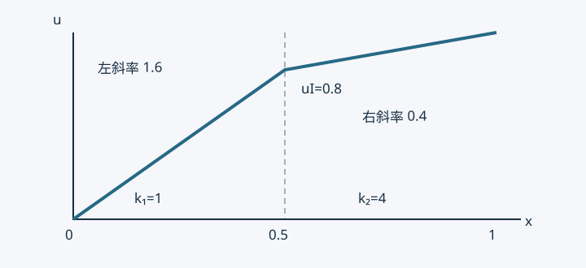

# 10 · 材料界面：连续的温度与可能跳变的梯度

> 课堂依据：照片 C08、C09 的分区域积分、相反法向与界面通量抵消。下面的双层材料例题、非理想接触说明和有限元实现解释为编写者补充。

## 一条曲线为什么成为“内部边界” {#kp-interface-model}

此前将导热率 $k$ 当作一个给定函数。两种材料接触时，它在界面两侧可能跳变。将区域写为 $\Omega_1\cup\Omega_2$，共同界面为 $\Gamma_I$，两侧常系数为 $k_1,k_2>0$。温度在各自内部满足

$$
-\nabla\cdot(k_r\nabla u_r)=f_r,\qquad r=1,2.
$$

$u_r$ 是同一温度场在子区域上的限制，$f_r$ 是该侧体热源。若界面理想接触、没有面热源，模型还需

$$
u_1=u_2\quad\text{及}\quad k_1\partial_{n_1}u_1+k_2\partial_{n_2}u_2=0\quad\text{在 }\Gamma_I.
$$

这里 $n_r$ 是子区域的外法向；同一界面上 $n_2=-n_1$。前一式是温度连续，后一式表示流出第一种材料的热流正好流入第二种材料。它不是两个法向导数数值直接相等。

## 逐区域分部积分，界面项去哪了 {#kp-interface-weak}

取在外部 Dirichlet 边界为零、跨界面连续的检验函数 $v\in H^1$。每个子区域分部积分：

$$
\int_{\Omega_r}k_r\nabla u_r\cdot\nabla v\,\mathrm dA-\int_{\partial\Omega_r}k_r\partial_{n_r}u_r\,v\,\mathrm ds=\int_{\Omega_r}f_rv\,\mathrm dA.
$$

把两个式子相加。两条子区域边界都包含 $\Gamma_I$，但法向相反；因检验函数在两侧有同一个迹，界面部分为

$$
-\int_{\Gamma_I}\left(k_1\partial_{n_1}u_1+k_2\partial_{n_2}u_2\right)v\,\mathrm ds=0.
$$

剩下的就是外边界贡献。若外边界分为 $\Gamma_D,\Gamma_N,\Gamma_R$，在非 Dirichlet 部分规定 $k\partial_nu+\alpha u=g$，其中 Neumann 部分 $\alpha=0$，得到

$$
\sum_{r=1}^2\int_{\Omega_r}k_r\nabla u\cdot\nabla v\,\mathrm dA+\int_{\Gamma_R}\alpha uv\,\mathrm ds
=\sum_{r=1}^2\int_{\Omega_r}f_rv\,\mathrm dA+\int_{\Gamma_N\cup\Gamma_R}gv\,\mathrm ds.
$$

这是课堂照片里界面括号为零的原因。不能只因“它在内部”便删掉界面项：用到了理想接触、无面源、守恒通量和连续检验函数这些条件。

## 双层材料的解析例题 {#kp-interface-example}

单位截面积杆长 1，界面 $a=1/2$，无体源。取 $k_1=1,k_2=4$，端温 $u(0)=0,u(1)=1$，坐标与物性用相容单位。数学通量 $p=ku'$ 在两侧相同。两段温差分别为 $pa/k_1$ 与 $p(1-a)/k_2$，总和为 1，因此

$$
p=\frac1{a/k_1+(1-a)/k_2}=\frac85.
$$

于是

$$
u(x)=\begin{cases}\dfrac85x,&0\le x\le1/2,\\[4pt]\dfrac45+\dfrac25(x-1/2),&1/2\le x\le1.\end{cases}
$$

界面温度是 $4/5$，左斜率 $8/5$、右斜率 $2/5$，相差四倍；乘导热率后均为 $8/5$。物理沿 $+x$ 热流为 $q_x=-8/5$，表示热从右端向左流。

图的拐点是材料引起的物理解，不是绘图误差。若错误强迫两侧斜率相同，就不能同时满足这两个导热率下的通量平衡。

## 有限元如何处理界面 {#kp-interface-fem}

网格边与材料界面对齐、跨界面共享温度节点时，连续形函数自然表达温度连续。各单元按自己的材料系数积分，再装配；弱形式把通量平衡以积分意义纳入节点方程。一般离散通量不在每个边点都严格连续，不能把弱平衡说成逐点完全守恒。

上面一维例子只需两个线性单元，长度各 $1/2$，刚度分别为 $2$ 与 $8$ 乘标准 $2\times2$ 扩散块。界面自由行是 $(2+8)u_I=2u_0+8u_2$，得到 $u_I=0.8$，两侧线性恢复恰为解析解。实验脚本检查两侧通量相等。

若网格单元跨越材料界面，则不能不加说明地将跳变系数用任意平均替代。需分区积分、界面对齐网格或适当的界面方法；方法选择取决于几何和误差目标。

## 适用边界：界面有源或接触热阻 {#kp-interface-limits}

上述连续温度适用于理想接触。若界面有接触热阻，可允许温度跳跃并建立“热流与温差成正比”的界面定律；若有面热源，则两侧外向热流之和不再为零。它们需要新的模型与试探空间处理，不能直接套用本章抵消结论。

自测：把 $k_1,k_2$ 交换后，界面温度是多少？答案为 $0.2$，热通量大小仍为 $1.6$。在两侧相同系数时，拐点应消失。至此，现有课堂材料中的标量扩散、单元插值、装配与界面主线闭合；更多方向列于[复习与预习](./07-复习与预习.md#kp-future)。
