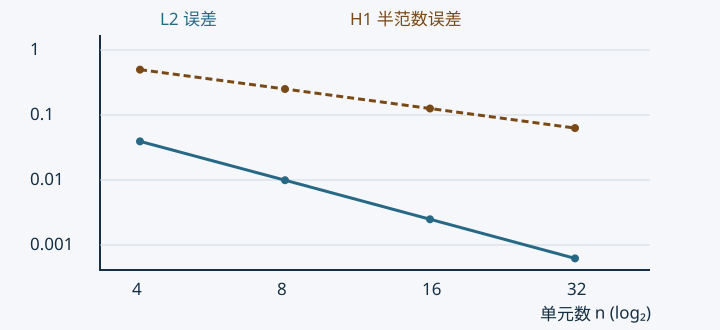

<script setup>
import { withBase } from 'vitepress'
</script>

# 例题、自测与可复现实验

本页所有练习和参考解由编写者自拟，不是教师作业或官方答案。原始资料没有提供可独立核实的正式作业文件，因此不虚构原题。课堂中的方法与这里用于验证方法的例题分别记录。

## 先手算，再运行

| 练习 | 思路 | 参考结果 |
| --- | --- | --- |
| $-T''=2,T(0)=0,T(1)=1$，四等分差分 | 写正对角矩阵，右端加入已知端温 | 内点 $7/16,3/4,15/16$，精确解 $2x-x^2$ |
| 两单元杆 $ES=1,L=1,f=2,P=1,u(0)=0$ | $K^e=(1/\ell)[1,-1;-1,1]$，均布力各分一半，末端加 $P$ | $u(1/2)=5/4,u(1)=2$，精确解 $u=3x-x^2$ |
| 长 2 的 Robin 直边，$\alpha=3,g=4$ | 积分两个线性边形函数 | $K^\gamma=[2,1;1,2]$，$f^\gamma=[4,4]^T$ |
| 单位正方形 Q4，$k=1$ | 积分 $B^TB$ | [完整矩阵](./08-二维单元刚度矩阵与总体装配.md#kp-q4-matrix) |
| 三角形 $(0,0),(2,0),(0,1)$，节点值 $(1,3,2)$ | 解三个节点插值条件 | $u_h=1+x+y$，能量为 2 |
| 两层材料 $k_1=1,k_2=4$，各长 $1/2$ | 串联热阻或两个单元装配 | 界面温度 0.8，数学通量 1.6 |

第一题详解见[差分章](./02-一维稳态热传导的有限差分法.md#kp-fdm-system)。第二题的两单元长度为 $1/2$，单元矩阵是 $2[1,-1;-1,1]$，每个单元载荷为 $[1/2,1/2]^T$。装配且消去首节点后：

$$
\begin{bmatrix}4&-2\\-2&2\end{bmatrix}\begin{bmatrix}u_1\\u_2\end{bmatrix}
=\begin{bmatrix}1\\3/2\end{bmatrix}.
$$

解为 $u_1=5/4,u_2=2$。节点恰为精确值是常系数一维特殊性质，单元内线性恢复仍不等于二次精确曲线，应变误差也不为零。

## 可运行的实验

项目内命令（Python 3.10+，依赖 NumPy）：

```sh
python -m pip install numpy
python scripts/experiments.py
```

<a :href="withBase('/experiments.py')" download>下载实验源码</a>后，应放在本项目 `scripts/experiments.py` 运行，因为图和结果使用固定项目相对目录。输入是脚本内解析模型，无外部数据；没有随机模拟，因此无需随机种子。结果写入项目根目录 `实验结果.json`，教学图写入 `笔记整理/assets/`。下载链接由站点构建提供，源码为同一份脚本的构建副本。

计算检查涵盖差分源项符号、非零边界、Neumann 零模态、杆件二次刚度、Q4 积分与特征值、三角形插值/能量、非对称 Jacobian 的梯度变换、双层材料通量和收敛阶。程序遇到失败会抛出错误，不能通过删除检查来交付。

## 用正弦解观察误差

制造一个已知精确解的问题：$u(x)=\sin(\pi x)$，于是 $-u''=\pi^2\sin(\pi x)$，两端为零。分别用一维线性有限元和中心差分求解。有限元载荷与误差使用五点 Gauss；$L^2$ 误差度量场值，$H^1$ 半范数误差度量一阶导数。



图的横轴按 $\log_2n$ 等距，纵轴按 $\log_{10}$ 误差等距，连线与虚线同时区分两组量。它是当前光滑模型的数值验证，不是一般收敛定理的证明。

| 单元数 | FEM $L^2$ | FEM $H^1$ 半范数 | FDM 节点最大误差 |
| --- | --- | --- | --- |
| 4 | 0.03928435 | 0.49850847 | 0.05302929 |
| 8 | 0.00992092 | 0.25118177 | 0.01295075 |
| 16 | 0.00248650 | 0.12583316 | 0.00321896 |
| 32 | 0.00062202 | 0.06294691 | 0.00080358 |

最后两层的观测阶分别约为 2.00、1.00、2.00；脚本按 $\log_2(e_h/e_{h/2})$ 实际计算并检查。误差表来自已执行实验，完整精度见 JSON。

## 可以继续做的变化

将热源改成另一条光滑函数时，先推导相应精确解再比较；把材料界面移到非中点时，应同时改网格/积分与解析热阻。不得只看一张更平滑的图就判断精度提高。更多概念题见[复习页](./07-复习与预习.md)。
